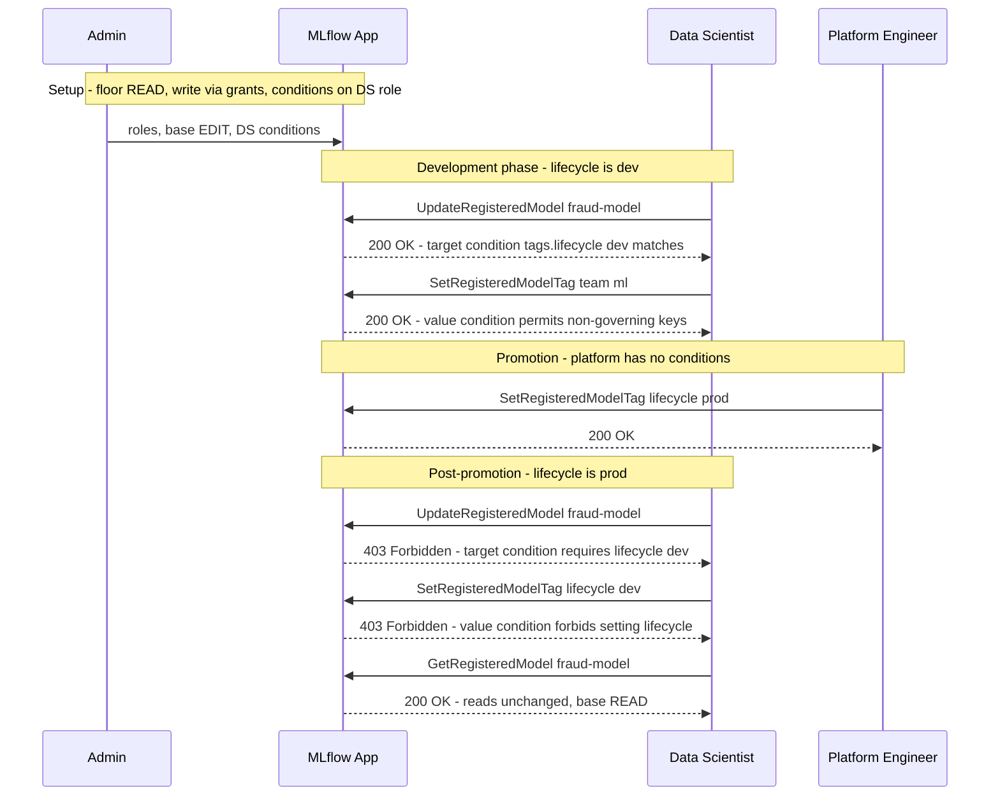
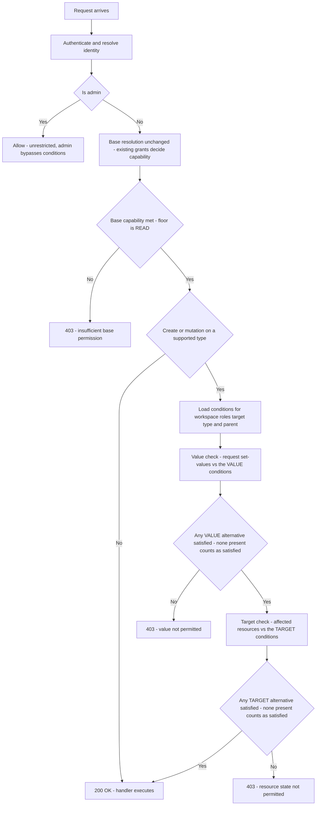
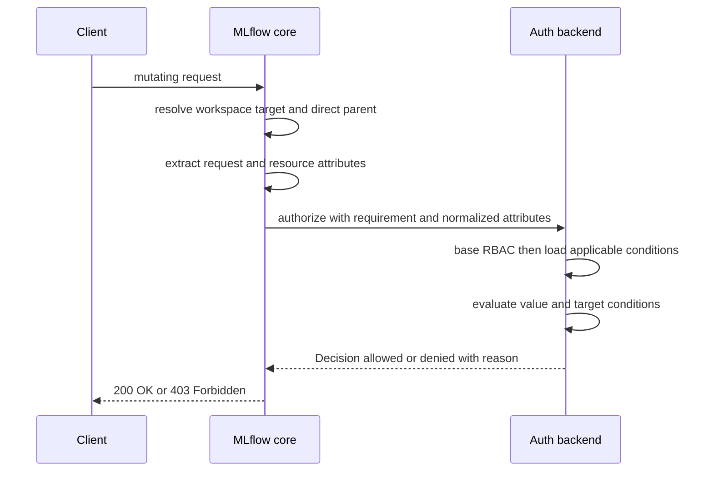
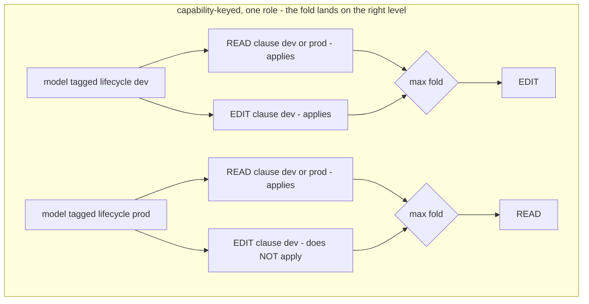
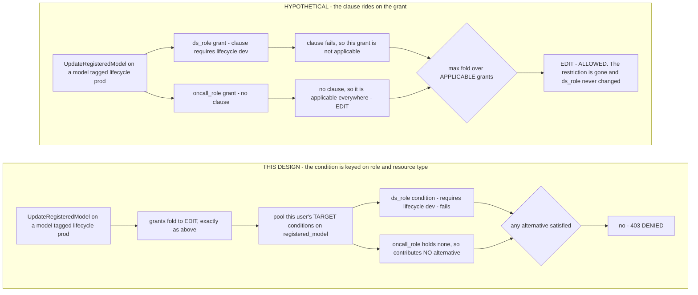
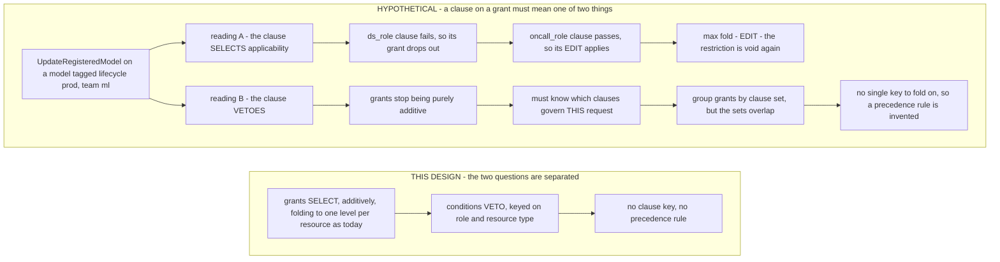
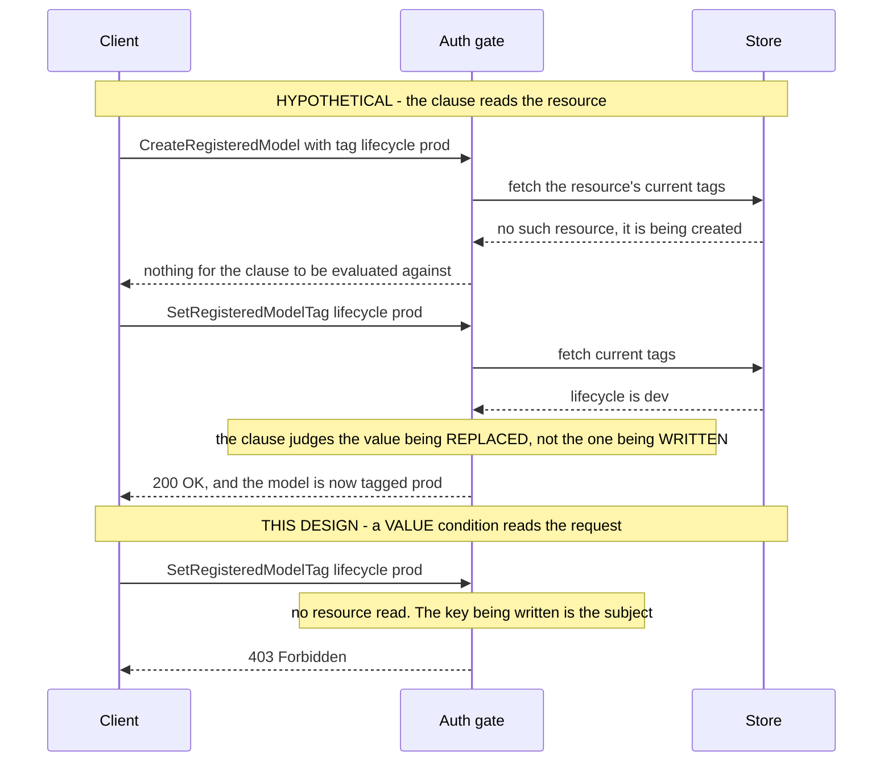
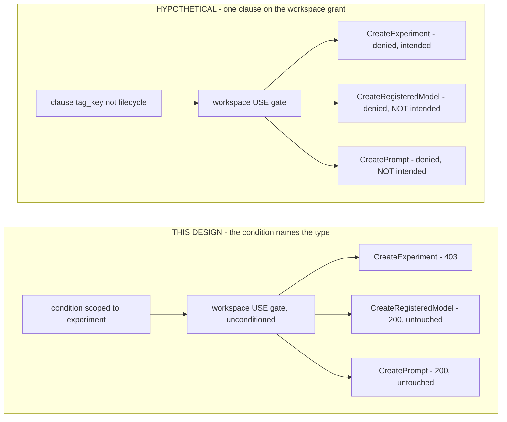

start_date: 2026-08-18
mlflow_issue: https://github.com/mlflow/mlflow/issues/24742
rfc_pr:

# Summary

MLflow RBAC grants access based on resource type and identity. It does not consider
resource state or the values a request tries to set. Once a user has EDIT on registered
models in a workspace, they can modify any registered model regardless of its lifecycle
state, and can set any tag or alias on it. There is no way to express "this user can edit
dev models but not production ones" or "only the platform team may set the `@champion`
alias."

This RFC proposes **conditions**: up to 100 role-owned condition objects per
`(role, resource_type)`. Each object optionally carries a value condition and a target condition
and is scoped to the role's workspace and target resource type. With no parent scope, it applies
to every target of that type in the workspace. With an exact direct-parent type and ID, it
applies only to matching children of that parent. Conditions gate **create/mutation** operations,
never reads:

- A **value condition** constrains *what values* a role may set, meaning the tag or alias in the
  request.
- A **target condition** constrains *which existing resources* a role may mutate, by their
  current tags or aliases.

Each condition is an AND-ed filter in MLflow's existing filter grammar. A condition only ever
*further-restricts* an operation the role's base grant already allows, and never confers access.
The guiding principle is that **grants add and conditions subtract**: base grants combine across
roles to decide what a role can do, and the applicable conditions -- pooled across every role the
user holds -- then restrict it. Conditions are **alternatives**: the clauses inside one condition
are AND-ed, and the conditions themselves are OR-ed, so an operation is permitted when it
satisfies at least one of them. When a resource's tags change (for example when it is
promoted to production), access adjusts automatically without admin intervention, and the
resource never moves, so lineage is preserved.

# Basic example

A data science team and a platform team share a workspace. Data scientists iterate freely
on dev models. Once a model is promoted to production, only the platform team may modify
it, while the model stays in the same workspace.

```python
# Base roles: keep the floor at READ so write always arrives via a grant.
ds_role       = client.create_role(name="data-scientist", workspace="ml-team")
platform_role = client.create_role(name="platform-eng",   workspace="ml-team")

client.add_role_permission(ds_role.id,       "registered_model", "*", "EDIT")
client.add_role_permission(platform_role.id, "registered_model", "*", "EDIT")

# Two conditions for (ds_role, registered_model), one of each type. The types AND, so both hold.
#  - TARGET: may mutate only resources currently tagged lifecycle=dev
client.add_condition(
    role_id=ds_role.id,
    resource_type="registered_model",
    type="TARGET",
    filter="tags.lifecycle = 'dev'",
)
#  - VALUE: may not set the governing lifecycle tag, nor the champion alias. Both restrictions
#    belong in ONE value condition: a second one would be an alternative, and anything it
#    permits is permitted no matter what this one forbids.
client.add_condition(
    role_id=ds_role.id,
    resource_type="registered_model",
    type="VALUE",
    filter="tag_key != 'lifecycle' AND alias != 'champion'",
)
# Platform role: no conditions, so it is unconstrained and may promote and edit prod.
```

**Lifecycle:**



The resource never moved. Lineage is intact. Write access changed dynamically based on the
tag value, and the DS cannot set the governing tag to unlock itself.

# Motivation

MLflow RBAC grants match resources by exact ID or wildcard (`*`). There is no way to express
"grant access to resources matching a condition" or "restrict the values this operation may
set," which forces admins into coarse choices. The following use cases are not supported
today and would be enabled by this proposal. Each is shown with the concrete mutation
condition that expresses it (see *Detailed design*). All gate **create/mutation** operations
only, and reads are unchanged (see *Out of scope*).

**1. Dev/prod boundary within a team.** A data science team works in a single workspace.
During experimentation, resources are freely editable. Once work is promoted to production,
it should no longer be modifiable by the dev team, only the platform team. Since the resource
originated in the same workspace, the only current way to enforce this is to move it to
another workspace, which is not trivial. Moving a resource breaks lineage because of
cross-workspace references. A sub-resource such as a run, trace, or logged model resolves its
workspace through its parent experiment, so moving it changes its parent experiment and
severs the experimental history that parent records.
- **Target condition:** `type="TARGET", filter="tags.lifecycle='dev'"` on the DS role's
  `registered_model`.
- **Result:** DS may mutate a resource only while it is tagged `lifecycle=dev`. When the tag
  flips to `prod`, the target condition stops matching and write access evaporates
  automatically, with no admin action and no move. Read stays, so prod remains visible.

**2. Alias/promotion protection.** Only designated users should be able to set
production-ready-indicating aliases (for example `champion` or `production`) on a registered
model. Today, anyone with EDIT can set any alias. A deployment script that pulls models by
such an alias would pick up any model a DS promoted, even with no review.
- **Value clause (DS):** `alias NOT IN ('champion', 'production')`
- **Result:** DS may set any alias except the protected ones. The platform role carries no
  condition at all, so it is unconstrained and may. This gates the value being set.

**3. Restricting mutation inputs.** A data scientist needs EDIT to update descriptions and
set benign tags, but should not be able to set operationally significant tag keys (for
example `lifecycle` or `approved`). Today, EDIT grants unrestricted access to all tag and
alias operations.
- **Value clause:** `tag_key != 'lifecycle'`
- **Result:** all tag writes are allowed except the protected key, at both create and update.
  This protects the target condition in use case 1: without it, a dev user could simply change
  the governing tag to escape the lock.

These become **two** condition objects on `(ds-role, registered_model)`, as in *Basic example*:
use case 1 is the TARGET condition, and use cases 2 and 3 are two clauses of a single VALUE
condition. The types AND, so both hold. Authoring 2 and 3 as separate VALUE conditions would
instead make them alternatives, and because a request that sets no alias satisfies an alias
filter vacuously, each would be lifted by the other's silence and neither protection would
survive. See *Drawbacks*.

Conditions solve these by making a *write operation* dynamic. The **target condition** follows
the resource's tags, and the **value condition** constrains the values a request may set.
Neither requires moving resources or per-resource admin work.

## Out of scope

- **Read-scoping / hiding resources on read.** If a user already has workspace access and could
  read a resource, this RFC does **not** hide it. Reads stay as today, and conditions are
  evaluated only during **create/mutation** authorization.

  This is the same constraint that holds sub-resource grants at wildcard grain in the merged
  sub-resource-permissions RFC: a wildcard check is one boolean per resource type, whereas a
  per-resource predicate has to be applied to every row of an unbounded result set. Enforcing a
  condition on read therefore needs the authorized predicate pushed into the store query before
  it runs, which is tracked in
  [mlflow/mlflow#24964](https://github.com/mlflow/mlflow/issues/24964) and has no merged
  implementation. Pushdown is also not uniformly available: the condition vocabulary is tags and
  aliases, and no search parser accepts an alias key at all, while tag `IN`/`NOT IN` is accepted
  only for traces. A vocabulary wider than search can express means some conditions would hold on
  mutation and silently not in a listing, and a restriction that holds on one route but not
  another is worse than no restriction at all. The remaining alternative, post-response
  filtering, degrades in proportion to how well the restriction works: the refill loop shrinks
  its shortfall by the authorized fraction on each pass, so filling one 100-row page costs
  roughly 6 store queries when half the rows are visible and roughly 460 when one percent are. A
  condition that narrows a role to a small slice -- the intended use -- is the worst case for
  filtering after the fact.

  The schema does not presuppose this exclusion. The table and object are named for conditions
  generally rather than for mutations, and search support would arrive as a **third condition
  type** beside the two defined here: `VALUE` gates what a request may set, `TARGET` gates which
  existing resources may be mutated, and a future `SEARCH` would gate which resources a listing
  returns. That is one additional enum value -- no new column, and no existing row changes
  meaning.

  A separate type rather than a flag on the existing ones is what keeps this additive, for two
  reasons. **Validation differs:** a search condition may use only what search can push down, so
  it has to reject alias clauses and the comparators a given type's parser does not accept, while
  `TARGET` keeps the full vocabulary. Its value budget differs too, since a listing combines every
  applicable condition into one predicate where a mutation evaluates them independently. **The
  absence rule may differ:** a target condition **fails on absence**, since
  a resource lacking the tag does not satisfy the clause, which is the strict direction for a
  mutation but would hide every untagged resource from a listing. Whether a search condition
  keeps that rule or needs an explicit absence policy is not decided here, and a distinct field
  lets that be answered without disturbing mutations.

  A search condition would subtract from the read grant exactly as the other two subtract from
  write grants, so it could never reveal a resource the base grant does not already permit. It
  would govern listings specifically and not point reads: a resource hidden from a search stays
  readable by a caller who already knows its ID. That makes it discovery hygiene rather than
  confidentiality, and the boundary has to be stated when the field is specified rather than left
  for an admin to infer from the name.
- **Cross-workspace conditions.** Conditions inherit exactly one workspace through their role. A
  condition that applies across every workspace would require a cross-workspace role or a
  separate global-policy binding, neither of which exists in this design.
- **Parent-attribute predicates.** A parent scope selects a child by its exact direct-parent
  type and ID. It does not read mutable attributes from the parent, so "lock all runs whose
  parent experiment is tagged `lifecycle=prod`" is not expressible in the initial
  implementation.
- **Per-operation target granularity.** The target condition applies uniformly to all mutating
  operations on a type. Distinguishing "editable while `dev`, deletable only while `prod`" would
  require per-operation target conditions; this is intentionally not supported in favor of the
  simpler uniform model.
- **Per-capability conditions.** A condition carries no level, so it narrows every capability the
  role holds on that type alike. "May read models tagged `lifecycle=prod` or
  `lifecycle=dev`, but may only edit the `dev` ones" is therefore not expressible here: the
  write half is a `TARGET` condition
  on `lifecycle=dev`, but the read half needs `SEARCH`, which is out of scope above.

  That expectation is a reasonable one, and the shape chosen here is what keeps it cheap rather
  than what forecloses it. The missing piece is a capability selector on the condition: when a
  request checks capability C, keep the conditions whose selector names C or names nothing, and
  combine them exactly as today. The grant fold is untouched -- it still resolves one effective
  level per resource -- so this is one optional column plus a filter applied ahead of the
  existing combination, not a change to how permissions are resolved. Because capabilities are
  already tracked individually (`can_read`, `can_update`, `can_delete`, and so on), that one
  selector would also subsume the per-operation granularity above. Attaching conditions to
  grants is what would make this harder rather than easier: the fold would then have to run once
  per matching condition set rather than once per resource, and because conditions may overlap,
  one request can match several, which leaves no single key to fold on.
- **Fields beyond tags and aliases.** The initial implementation conditions only on tag and
  alias values (the value namespace `tag_key`/`tag_value`/`alias`, and the target namespace
  `tags.*`/`aliases.*`). The design is extendable to other request and resource fields.
- **Assessment-owned conditions.** Assessments have no tag or alias vocabulary of their own.
  Assessment mutations are authorized against their trace, so a trace condition can gate them,
  but a condition on an assessment's metadata or feedback values is out of scope.
- **Owner-based conditions** ("only modify resources you created"). This requires ownership
  tracking and is a separate feature.

# Detailed design

## API changes

### Conditions and their fields

A role may have up to 100 condition objects of each type for each target resource type. Each
object carries a stable ID, a type, one filter, and an optional exact direct-parent scope:

```
Condition {
    id:                   string    # stable id, assigned on add; addresses update/remove
    role_id:              int       # the role the conditions apply to
    resource_type:        string    # authorization target, e.g. "registered_model_version"

    # What the filter governs. VALUE gates the values a request may set; TARGET gates which
    # existing resources may be mutated. The two types answer different questions and so combine
    # with AND, while conditions sharing a type are alternatives and combine with OR. Search is
    # out of scope in this RFC; if search conditions are added later they arrive as a third
    # value on this field rather than as a new column.
    type:                 enum      # VALUE | TARGET

    # Optional direct-parent selector. Both fields are null for workspace/type scope; both are
    # set for parent scope. The pair must be a supported direct-parent relationship for the
    # target type, e.g. registered_model_version under registered_model/fraud-model.
    parent_resource_type: string | null
    parent_resource_id:   string | null

    # The filter, never null. For VALUE it reads the request and ranges over tag_key, tag_value
    # and alias, and it applies to create as well as mutation. For TARGET it reads the target's
    # current state and ranges over tags.<key> and aliases.<name>, and it is vacuous on create.
    filter:               string
}
```

A condition without a parent scope applies to every target of its `resource_type` in the role's
workspace. A condition with a parent scope applies only when the validator resolves the target's
exact direct parent to that type and ID. Conditions do not inherit across resource types: a
workspace/type-scoped `run` condition does not apply to traces or logged models.

**An unresolved parent must fail closed.** A parent-scoped condition is selected by matching the
target's resolved parent, so a validator that mutates a child type but cannot supply that parent
would match no scoped condition at all -- the restriction would silently stop applying, with
nothing observable to distinguish it from no restriction being configured. A mutating operation on
a child type whose parent cannot be resolved must therefore be refused, not treated as unscoped.
A parentless type (`experiment`, `registered_model`, `prompt`, `mcp_server`) supplying no parent is
the ordinary case and is unaffected.

Each non-null condition is a single filter in MLflow's existing search filter grammar: a set of
comparison clauses AND-ed together, for example `tags.lifecycle = 'dev'` or
`tag_key != 'lifecycle' AND alias != 'champion'`. A value being set, or a resource being
mutated, satisfies that condition when it matches every clause. `!=` and `NOT IN` express
exclusion *within* one condition; because conditions are alternatives, that exclusion is not
absolute and can be bypassed by a sibling condition that permits the same request. There is no
separate deny form in this RFC; see *Drawbacks* and *Alternatives C*.

The optional parent scope filters which condition objects are applicable before they combine.
At least one applicable condition object must be satisfied, and applicable objects are pooled
across every role the user holds. Conditions scoped to different parents therefore do not
conflict for a single child, while unscoped conditions apply
to every parent. Like grants, conditions are scoped to a workspace through the role; the
condition has no workspace column of its own.

### Admin Apis

Four operations manage conditions, mirroring the existing `add`/`update`/`remove`/`list`
role-permission API. `add` creates a `Condition` object and returns it with an assigned `id`;
`update` and `remove` address an existing object by that `id`; `list` returns a role's objects.
Their request and response shapes:

```
add(role_id, resource_type, type, filter, parent_resource_type?, parent_resource_id?)
    -> Condition
    # Creates ONE object of ONE type. The parent fields are both omitted/null for workspace/type
    # scope or both set for exact direct-parent scope. Rejects an unsupported parent
    # relationship, a missing type or filter, an invalid filter, or a
    # (role, resource_type, type) that already holds 100 objects.
    #
    # Every object sharing a (role, resource_type, type) is an ALTERNATIVE: a request satisfying
    # any one of them passes that type. Adding an object can only widen what the role may do,
    # never narrow it. Prefer ONE condition per type, with its clauses AND-ed inside the filter.
    # This is worth surfacing in any authoring UI, because a second condition of the same type
    # is the likeliest way for an admin to defeat a restriction they already authored -- a field
    # the new condition does not name is a field it permits.
    #
    # The caller does not choose the slot. The backend allocates an unused slot from 1 through
    # 100; the slot UNIQUE constraint handles a concurrent allocation collision, which is
    # retried. The slot is implementation metadata and has no policy ordering meaning.

update(id, filter?, parent_resource_type?, parent_resource_id?)
    -> Condition
    # Partial update by id:
    #   - an omitted field is unchanged;
    #   - a filter string replaces the filter; it cannot be cleared, because a condition with no
    #     filter has no meaning -- use remove instead;
    #   - the parent pair is replaced together by an exact pair or two nulls;
    #   - type is immutable. Each type's filter draws on its own namespace, so re-typing a
    #     condition would almost always invalidate its filter. Remove and re-add instead.

remove(id) -> {}
    # Deletes one Condition object.

list(role_id) -> { conditions: Condition[] }
    # Returns every condition object on the role, including its scope and stored filters.
```

The default auth backend implements these operations. A pluggable backend that does not support
conditions returns a feature-not-supported response rather than accepting a rule it will not
evaluate.

### Limits and restrictions

- **Same-type conditions OR, the types AND.** For an operation, base RBAC must pass, at least
  one applicable VALUE condition must pass, and at least one applicable TARGET condition must
  pass. Conditions sharing a type are alternatives. The two types answer different questions, so
  they combine with AND: OR-ing across them would permit a forbidden value on a permitted
  resource, or a permitted value on a forbidden resource.
- **A type with no applicable condition is unconstrained.** A user holding no applicable VALUE
  condition may set any value, and likewise for TARGET. Absence is not a restriction, so a role
  carrying no conditions contributes nothing to either disjunction and does not exempt the user
  from conditions carried by their other roles.
- **Applicable conditions pool across roles.** Each type's disjunction is taken over every
  applicable condition of that type from every role the user holds.
- **Scope selects before combination.** A parent-scoped condition is considered only for a child
  whose resolved direct parent matches its scope. An unscoped condition applies to every parent
  of the target type in the role's workspace.
- **Grants add, conditions subtract across roles.** A user's capability is the union of what
  their roles grant, exactly as today, and the conditions applicable to that capability are
  pooled across every role they hold. An *absent* condition cannot lift a restriction, because a
  role with no conditions contributes no alternative. A *permissive* condition can, including one
  carried by a different role and administered by a different person.
- **Non-monotonic in both directions.** Adding a role that carries a condition can reduce what a
  user may do, because a user with no applicable condition is unconstrained while a user with one
  is held to it. Adding a role whose condition is more permissive can *increase* what they may
  do, because it supplies another alternative. Neither direction follows from the grant level.
- **Conditions that disagree widen rather than conflict.** If applicable conditions require
  `tags.lifecycle = 'dev'` and `tags.lifecycle = 'prod'`, the user may mutate either, because
  each is an alternative. This is the opposite of AND combination, which would have permitted
  neither.
- **At most 100 condition objects per `(role, resource_type, type)`.** This bound includes both
  workspace/type-scoped and parent-scoped objects. Roles are workspace-scoped, so the bound
  never spans workspaces; it is not an aggregate quota across every role in a workspace.
- **At most 5 clauses per filter.**
- **Reserved `mlflow.*` tag keys cannot be named in either namespace.** A condition may not use
  `mlflow.`-prefixed key as a `tag_key` value, nor as a `tags.<key>` identifier. Two reasons, and
  they point the same way. MLflow writes these itself (`mlflow.runName`, `mlflow.source.type`), so
  a value condition naming one would block MLflow's own bookkeeping. And because no value
  condition can gate them, they remain freely settable -- so a target condition reading one
  restricts nothing in practice: the holder sets the tag to whatever passes, and
  `tags.mlflow.runName != 'secret'` is defeated by renaming the run. A rule that cannot be
  enforced should not be storable, because the admin would believe a restriction is in force.
  User-owned keys that merely contain the string (`mlflow_stage`, `team.mlflow.note`) are
  unaffected; the test is on the prefix.
- **Ordering comparators are rejected.** `=`, `!=`, `LIKE`, `ILIKE`, `IN` and `NOT IN` are
  allowed. `>`, `<`, `>=` and `<=` are not: tag and alias values are strings, so an ordering
  comparison would be lexicographic and would mislead an admin into thinking they had expressed a
  numeric or temporal range. `!=` and `NOT IN` supply exclusion within a condition.
- **No `OR` operator inside a filter string.** Disjunction is expressed by authoring multiple
  condition objects rather than by an `OR` inside one filter. This preserves reuse of MLflow's
  AND-only parser and matcher, and `IN`/`NOT IN` already cover same-field alternatives within a
  clause. In-filter OR would require a separate parser and evaluator and its own absent-field
  semantics for value conditions.

## Changes to the auth call path

### Order of evaluation

For an operation by a user on a resource, the decision is the logical AND of the base grant
check, the value condition, and the target condition. The process is as follows:



The value condition is read from the operation itself, so it applies uniformly to a create
(authorized by the workspace create gate) and a mutation (authorized by the resource update
gate), layering on top of whatever grant authorized the operation independent of permission
level.

### The set a target condition is evaluated over

A target condition is evaluated over the resources an operation affects, which is not always the
resource the request names. `TransitionModelVersionStage` with `archive_existing_versions` moves
every other version already in the target stage to `Archived`, and a cascade delete or restore
reaches every child of its container. Those resources are mutated by a request that never
mentions them, so a route that can trigger one declares the extra population and the gate judges
it alongside the named resource. Without that declaration the stages API would be a way around
any target condition on versions: the restriction would hold for the version transitioned and be
bypassed for every version archived.

The population is declared, never enumerated. A cascade context names the PARENT and a child
type, and the gate asks the store a single question: does this parent hold a child that fails?
That query is reached only once the gate knows a condition for that tier exists, so a cascade on
a server with no conditions costs what it did before. The archive cascade is narrowed further
to the stage the archive actually reaches, because judging every version of the model would
refuse a transition into a stage holding nothing objectionable.

Two consequences are worth stating plainly rather than leaving to be discovered:

- **This is a property of condition evaluation, and the base grant check is not extended to
  match.** The requirement these routes already issued is unchanged. A deployment relying on
  grants alone therefore has exactly the exposure it has today: the archive is authorized by the
  caller's permission on the version type, not by a per-resource check of everything the archive
  reaches. Conditions are evaluated over a wider set than grants are, and that asymmetry is
  deliberate -- widening the grant check would change existing authorization outcomes on servers
  that have no conditions at all.
- **A route that can cascade but does not declare it is unrestricted for conditions too.** The
  declaration is per route, so coverage comes from having enumerated the cascading operations
  rather than from anything the framework derives. The operations wired for the initial launch
  are listed in the next section.

## Subset of resource types and their fields for initial launch

The condition framework is resource-type generic, but the initial release wires only the types
and operations below. A target condition reads the target's tags (plus aliases for model and
prompt parents); value conditions read only the request fields listed for that type. Direct
parent scope is supported only for the listed child-to-parent relationships.

| Resource type | Direct parent for scoped conditions | Target fields | Value-setting operations |
|---|---|---|---|
| `experiment` | none | `tags.*` | set-tag, delete-tag, create. Other mutations carry no value fields. |
| `registered_model` | none | `tags.*`, `aliases.*` | set-tag, delete-tag, set-alias, delete-alias, create. Other mutations carry no value fields. |
| `prompt` | none | `tags.*`, `aliases.*` | set-tag, delete-tag, set-alias, delete-alias, create. Other mutations carry no value fields. |
| `run` | `experiment` | `tags.*` | set-tag, delete-tag, create. Other mutations carry no value fields. |
| `trace` | `experiment` | `tags.*` | set-tag, delete-tag. Other mutations carry no value fields. |
| `logged_model` | `experiment` | `tags.*` | set-tags (batch), delete-tag, create. Other mutations carry no value fields. |
| `registered_model_version` | `registered_model` | `tags.*` | set-tag, delete-tag, create. Other mutations carry no value fields. |
| `prompt_version` | `prompt` | `tags.*` | set-tag, delete-tag, create. Other mutations carry no value fields. |
| `mcp_server` | none | `tags.*`, `aliases.*` | set-tag, delete-tag, set-alias. Other mutations carry no value fields. |
| `mcp_server_version` | `mcp_server` | `tags.*` | set-tag, delete-tag. Aliases are stored on the server, so an alias condition is keyed on `mcp_server`, never on the version. |

Notes:
- A target condition never restricts create because no target state exists yet. A value condition
  can restrict request values on create, including tags supplied at creation.
- A batch set-tags operation evaluates the value condition against each tag; if any tag fails,
  the operation is denied.
- Assessment create, update, and delete are authorized against the trace. A trace target
  condition can therefore gate assessment mutations, for example preventing an assessment from
  being added to a trace tagged `finalized=true`.
- **A tag deletion exposes the tag key as a request value.** Delete-tag is a value-setting
  operation for this purpose: the key being removed is matched against `tag_key` (with `tag_value`
  absent, so a `tag_value` clause is vacuous). Without this, a value condition such as
  `tag_key != 'lifecycle'` would block *setting* the governed tag while permitting its *deletion*,
  which is the same mutation in the direction that matters.
- Target conditions inspect the pre-mutation target state, so a delete is judged against the tag
  still being present. Deleting a tag a condition depends on does not escape the condition: on the
  target side an **absent** tag fails every comparator, so a target that no longer carries
  `tags.lifecycle` satisfies neither `tags.lifecycle = 'dev'` nor `tags.lifecycle != 'prod'`.
  Removing the governing tag therefore *loses* access rather than becoming unrestricted. This
  surprises admins -- `tags.lifecycle != 'prod'` denies an untagged resource -- but it is the
  fail-closed reading, and it is what prevents a two-step bypass.
- **A container delete is authorized against its children.** Deleting an experiment deletes its
  runs, traces, and logged models, so conditions on those child types must be checked before the
  delete is allowed; otherwise deleting the parent bypasses every condition on its children. The
  check asks only whether any child satisfies *no* applicable condition, an existence question
  rather than a selection one, so it never has to return the children themselves. It is
  nonetheless unbounded in child count, in the same way the delete it authorizes already is:
  `delete_experiment` loads every run of the experiment and marks each one individually.
  Validation is therefore chunked over children, with an early exit on the first child that
  satisfies no condition, and the UI should indicate that a delete is being validated, because on
  a large experiment the authorization is user-visibly slow for the same reason the delete itself
  is.

## Adaptability to Pluggable Auth (RFC 8)

Conditions fit RFC 8's single decision entry point, `authorize(query) -> Decision`, which
returns one decision. Value and target checks are stages inside that call, after the base grant
check. Core resolves the workspace, target, and direct parent as it already does for grants;
it passes normalized inputs to the backend but does not expose raw request bodies.

**What is wired to the backend.** The condition inputs ride additive, default-empty fields on
RFC 8's existing `AuthorizationRequirement`. The entry-point signature does not change:

```
AuthorizationRequirement {
    resource_type          # existing authorization target type
    resource_id            # existing authorization target ID
    action                 # existing
    workspace              # existing
    parent_resource_type   # ADDED: resolved direct parent type, if any
    parent_resource_id     # ADDED: resolved direct parent ID, if any
    request_attributes     # ADDED: normalized attempted set-values
    resource_attributes    # ADDED: target current tags and aliases
}

authorize(subject, requirement) -> Decision
```

A backend that supports conditions owns their storage, lookup, and evaluation. Core passes the
workspace/type/parent scope and normalized attributes; the backend loads only conditions on
roles held by the user in that workspace whose target type and optional parent scope apply. A
backend that does not implement the feature rejects condition management requests as unsupported
and may continue to make unconditional RBAC decisions for ordinary authorization requests.

Conditions are parsed and validated on write, then cached as parsed clauses by the default
backend for request-path evaluation. The stored and API representation remains the authored
filter string.

**Interaction when conditions are evaluated:**



## MLflow UI

Conditions surface as part of a role's configuration rather than as a separate policy system.

- **Display on roles.** A role detail view lists all of its condition objects alongside grants,
  grouped by target resource type and then by workspace/type scope or exact parent scope. It
  shows the value and target filter strings directly; an absent filter renders as none.
- **Create and edit.** An administrator with manage permission on the role can add, update, or
  remove conditions through the management API. The UI uses text fields in the same filter
  grammar as MLflow search and selects a supported exact parent when the target type is a child.
- **Model and prompt entry points.** A registered-model or prompt detail view can create a child
  version condition scoped to the model or prompt currently being viewed, without requiring the
  administrator to manually enter its parent ID.
- **Validation and errors.** The UI surfaces invalid-filter, unsupported-backend, invalid-parent,
  and 100-condition-limit errors. For a denied request, it can show the safe denial reason
  returned by the authorization decision, such as an unmatched `production` alias.
- **Read-only fallback.** A user who can view but not manage a role sees its conditions
  read-only, consistent with grants.

## Database schema changes

The default backend stores one row per condition object. Workspace is inherited from the role,
not duplicated in this table. For authorization, the backend joins user-role assignments to
roles constrained to the resolved workspace, then queries only conditions on those role IDs that
match the target type and either no parent scope or the exact resolved parent. A condition
workspace column would duplicate role-owned state and would not remove the role-assignment join
needed to exclude conditions on roles the user does not hold.

```sql
CREATE TABLE conditions (
    id INTEGER PRIMARY KEY AUTOINCREMENT,
    role_id INTEGER NOT NULL REFERENCES roles(id) ON DELETE CASCADE,
    resource_type VARCHAR(255) NOT NULL,
    condition_slot SMALLINT NOT NULL,
    condition_type VARCHAR(16) NOT NULL,
    parent_resource_type VARCHAR(255),
    parent_resource_id VARCHAR(255),
    filter TEXT NOT NULL,

    CHECK (
        (parent_resource_type IS NULL AND parent_resource_id IS NULL)
        OR
        (parent_resource_type IS NOT NULL AND parent_resource_id IS NOT NULL)
    ),
    CONSTRAINT unique_role_type_slot
        UNIQUE (role_id, resource_type, condition_type, condition_slot)
);

CREATE INDEX idx_conditions_lookup
    ON conditions (
        role_id,
        resource_type,
        condition_type,
        parent_resource_type,
        parent_resource_id
    );
```

The backend allocates slots 1 through 100 and retries when a concurrent insert collides on the
unique constraint. The lookup index retrieves only conditions for the current user's workspace
roles, target type, and scope; no query loads conditions from other users or workspaces. Filters
are validated on add or update and stored as authored strings. The default backend caches their
parsed clauses for request-path evaluation, while `list` returns the stored strings directly.
The table is additive, so deployments with no rows retain current default-allow behavior.

The table is named `conditions` rather than `mutation_conditions`, and no column names the
action: every column (`condition_type`, `filter`, `condition_slot`, `resource_type`,
the scope columns) is already action-neutral -- `VALUE` and `TARGET` name what a filter reads,
not which operation it gates. Search conditions are out of scope in this RFC, but nothing here
presupposes that: adding them later is one additional `condition_type` value rather than a new
column, a table rename, or a data migration. See *Out of scope*.

# Drawbacks

- **A restriction is only as strong as the most permissive alternative of its type.** Because
  same-type conditions are OR-ed, whichever condition has all its clauses fulfilled authorizes
  the whole request, even if it says nothing about the field being restricted. Two VALUE
  conditions `alias NOT IN ('champion')` and `tag_key != 'lifecycle'` do not combine: a request
  setting `alias=champion` alongside `team=ml` fulfils the tag condition on its own merits, so
  the alias clause fails and the write is still permitted. This needs no absent field, though
  absence widens it -- a request setting no alias at all satisfies the alias filter vacuously, so
  the two conditions also annihilate each other on single-field writes. TARGET conditions have
  the same exposure on create, where they are vacuous. A restriction therefore holds only if
  *every* applicable condition of that type is restrictive about the field -- in practice,
  keeping one condition per type and AND-ing its clauses -- and nothing in the data model
  enforces that it was done. The sibling may also be carried by a different role, administered by
  a different person. This is the same shape as an IAM policy set with no `Deny` statement and no
  permission boundary, with the added difference that an IAM condition key absent from a request
  makes its operator fail rather than pass; see *Alternatives C*.
- **Non-monotonic in both directions.** Adding a role that carries a condition can reduce what a
  user may do, because a user with no applicable condition is unconstrained. Adding a role with a
  more permissive condition can increase it, because that supplies another alternative. Admins
  who expect roles to only add access are surprised by the first; admins who expect conditions to
  only subtract are surprised by the second.
- **No system-enforced global invariant.** A user with no condition on a type is unconstrained
  there. Restricting a user requires placing a condition on a role they hold, so a guaranteed
  "nobody may ever set X" rule is a built-in hard check in the handler rather than a condition.
- **Type-level authoring, operation-level enforcement.** A condition is authored for a target
  resource type and optional parent scope, but it is enforced across every distinct operation
  that creates or edits that type. Each operation exposes the governed fields and direct parent
  differently, so the backend must classify and gate every covered operation individually.
- **No restriction on reads.** Conditions gate create and mutation only. They cannot restrict
  reads in the current design, so a user who holds read access to a resource sees all of its
  fields regardless of any condition. Hiding a field or resource requires the base grant, not a
  condition. The blocker is search-filter pushdown rather than the data model, and search support
  would arrive as a third condition type without reshaping what is here; see *Out of
  scope*.

# Alternatives

### A. Attach conditions to the existing grant (capability-keyed)

Extend the existing grant with condition clauses keyed by capability (update, delete, and so
on), rather than modeling a condition as its own object. This is the natural first instinct, and
in isolation it reads well: `(registered_model, *, READ, lifecycle=prod)` beside
`(registered_model, *, EDIT, lifecycle=dev)` expresses a per-level case directly.

**Rejected because** a restriction attached to a grant is only as strong as the grants nobody
attached it to. Three consequences, in descending order of weight:

- **A grant-attached restriction is void as soon as any other grant authorizes the operation.**
  Applicable grants fold by `max` on level, and a grant carrying no condition is applicable
  everywhere, so a single unconditioned `EDIT` grant -- what a broad platform role holds --
  re-opens everything a conditioned `EDIT` grant was narrowing. The restriction would have to be
  repeated on every grant that could authorize the operation, including grants on roles authored
  by other admins, and missing one voids it silently. Keying on `(role, resource_type)` instead
  composes: a user's conditions of a type are alternatives, but a role holding *no* condition
  contributes no alternative, so merely holding another role cannot lift a restriction. (A role
  holding a permissive *same-type condition* can, which is the gap recorded under *Drawbacks*.
  The point here is that the ordinary case -- an unconditioned role -- cannot.)
- **A grant has one condition slot, and request restrictions are not resource restrictions.** A
  condition hanging off a grant is naturally a predicate on the resource: this grant applies to
  models tagged `dev`. A value restriction has no resource to predicate on -- it judges the tags
  and aliases the request is trying to write, before any resource is read, and on a create before
  one exists. The slot would have to mean one of two different things depending on its content,
  which is the `condition_type` distinction reintroduced inside the grant rather than avoided by
  it.
- **Create is gated at the workspace level, so a create-time value restriction has no
  resource-type grant to hang off.** Attaching it to `(workspace, USE)` applies it to every child
  type at once -- experiments, registered models, prompts, scorers -- when the intent was one of
  them, and still leaves unsaid whether `lifecycle=prod` constrains what the caller may pass or
  which
  resources the caller may touch.

Keying the condition on `(role, resource_type)` with optional direct-parent scope, independent of
level, removes all three. This contrasts cleanly with the merged sub-resource-permissions RFC's
`NONE`, which is a grant because it is a level (absolute-deny), whereas conditions are not levels
and instead layer over whatever level the grants conferred.

**`condition_type` is not a capability in disguise.** `VALUE` and `TARGET` name which question a
filter answers -- what a request may set, versus which existing resources it may touch -- not
which capability it gates. The two are orthogonal in both directions: one operation can need
both, as in the *Basic example* above, where a single set-tag call is judged by a `VALUE`
condition on the tag being written and a `TARGET` condition on the model being mutated; and one
type spans many operations, as `TARGET` on `registered_model` governs set-tag, delete-tag,
set-alias, rename, and delete alike. They also differ mechanically, which is why one slot cannot
serve both: `VALUE` needs no resource read and treats a missing key as vacuous, while `TARGET`
fetches or pushes down a predicate and treats a missing key as a failure. Conditioning on the
capability as well remains reachable without disturbing any of this -- see *Out of scope*.

**Where extending the grant goes wrong.** Each case below is enforced by this design and covered
by the end-to-end suite. The claim is deliberately not that a clause on a grant cannot express
these restrictions -- for the most part it can, and the first case concedes that it expresses a
per-level restriction better than this design does. The claim is that one of two things happens:
either the restriction fails to compose, because it becomes a property of the grant carrying it
rather than of the role holding it, or the repair converges on the condition object by adding the
fields a condition already has. Each case shows the two object shapes side by side -- a `grant`
carrying a hypothetical `condition=` clause, against this design's separate `condition` object --
and then the flow the first shape gets wrong. The clause-carrying `grant` is **not** proposed
API; it stands for the capability-keyed shape and is shown failing.

**1. A restriction that has to survive the other roles its holder has.** "The data-science role
may mutate only `dev` models, whatever else the user holds." The role is the subject here, so the
objects are shown per role.

**What the capability-keyed shape does well.** A per-level restriction, which it states more
directly than this design does, and folds correctly.

```python
# HYPOTHETICAL capability-keyed shape -- not proposed API.
grant("registered_model", "*", "READ", condition="tags.lifecycle IN ('dev', 'prod')")
grant("registered_model", "*", "EDIT", condition="tags.lifecycle = 'dev'")
```



**What it cannot do.** Compose. The restriction is a property of the grant carrying it, not of
the role holding it.

```python
# HYPOTHETICAL -- ds_role restricted, and a second role authored by a different admin.
# ds_role
grant("registered_model", "*", "EDIT", condition="tags.lifecycle = 'dev'")
# oncall_role
grant("registered_model", "*", "EDIT")
```

```python
# This design.
# ds_role
grant("registered_model", "*", "EDIT")
condition("registered_model", type="TARGET", filter="tags.lifecycle = 'dev'")
# oncall_role
grant("registered_model", "*", "EDIT")
```



**Why clause fields on the grant do not fix it.** Leave no grant unconditioned, and the clause
has to mean one of two incompatible things.

```python
# HYPOTHETICAL -- the repair: clause fields on the grant itself, so none is unconditioned.
# ds_role
grant("registered_model", "*", "EDIT",
      read=None, value=None, target="tags.lifecycle = 'dev'")
# oncall_role -- a different admin, a different clause, also satisfied
grant("registered_model", "*", "EDIT",
      read=None, value=None, target="tags.team = 'ml'")
```



The same reasoning is why attaching conditions to grants would make the per-capability extension
harder rather than easier -- see *Out of scope*. A role carrying a permissive same-type condition
would still lift the restriction here -- see *Drawbacks*. A role carrying no condition cannot,
and that is the ordinary case.

**2. A restriction on what a request may set, where there is no resource to judge.** "May not
set the `lifecycle` tag."

```python
# HYPOTHETICAL -- there is nothing for the clause to read.
grant("registered_model", "*", "EDIT", condition="tags.lifecycle != 'prod'")
```

```python
# This design -- the two questions are different condition types.
condition("registered_model", type="VALUE", filter="tag_key != 'lifecycle'")
```

A resource clause reads the resource's *current* tags, which is the wrong side of the write. On a
create there is no row at all; on a set-tag the row exists but holds the value being replaced.



| Request under this design | Outcome |
|---|---|
| `CreateRegisteredModel(name="fraud-model", tags={"lifecycle": "prod"})` | 403 |
| `SetRegisteredModelTag("fraud-model", "lifecycle", "dev")` | 403 |
| `SetRegisteredModelTag("fraud-model", "team", "ml")` | 200 |

A `TARGET` condition deliberately does not gate a create, because no resource exists to judge.
That is why one clause slot cannot serve both questions.

**3. Conditioning one child type when the creates are authorized by a container grant.**
"Experiments this role creates may not carry `lifecycle`, while its prompt and model creates
stay unrestricted."

```python
# HYPOTHETICAL -- creates are gated at the workspace level, so the workspace grant is the
# only one available to carry the clause, and it authorizes every child type.
grant("workspace", "*", "USE", condition="tag_key != 'lifecycle'")
```

```python
# This design -- the condition names its own resource type; the grant is untouched.
grant("workspace", "*", "USE")
condition("experiment", type="VALUE", filter="tag_key != 'lifecycle'")
```



Adding a `resource_type` field to the clause so it can name `experiment` alone is the condition
object, arrived at from the other direction.

### B. Single operation-keyed condition object

Model one object keyed on the operation (for example update-registered-model) carrying request
and resource filters.

**Rejected because** the admin surface should be type-level, matching how grants are authored.
Operation-keying leaks operation names into the admin model and multiplies objects, one per
operation. The type-level condition objects capture the same power with a smaller, more familiar
surface; operation-level detail is kept internal in the field and parent mappings.

### C. Separate allow and deny filters, or a structured allow/deny value map

Give each condition both an allow filter and a deny filter, or encode the value condition as an
allow/deny map of key to permitted values.

**Deferred rather than rejected.** The original rejection rested on cross-role AND supplying
absolute restriction, which made `!=` and `NOT IN` within one condition sufficient and left a
deny channel adding a second combining rule with no added power. With conditions combining by OR
that premise no longer holds: exclusion inside one alternative is not absolute, so there is at
present no way to express a restriction a sibling condition cannot lift. A deny filter is the
mechanism that would restore it, and it is the direct analogue of an IAM `Deny` statement or a
permission boundary -- which is what makes an IAM restriction hold even though `Allow` statements
combine by union. It is left out of this RFC to keep a single combining rule in the initial
implementation, and the resulting gap is recorded under *Drawbacks*. A structured value map
remains a possible future authoring convenience over the same evaluation.

### D. Separate policy layer (admission-controller style)

A separate authorization engine after RBAC.

**Rejected because** it means two systems to reason about and is over-engineered for MLflow's
scale. Conditions keep the restriction co-located with the role and reuse the existing filter
grammar.

### E. Workspace isolation / resource groups / per-ID grants

Move resources between workspaces on promotion, or add a resource-group dimension, or enumerate
IDs.

**Rejected because** workspace moves break lineage and hit name-uniqueness collisions, and
sub-resources have no independent workspace mobility. Resource groups are a special case of a
target condition on one attribute. Per-ID grants do not scale and are not dynamic. Conditions
reuse existing tags and aliases, are dynamic since a tag change flips access with no admin
action, and are co-located with the role.

# Adoption strategy

**This is not a breaking change.** Deployments with no conditions behave exactly as today. Every
operation is default-allow at its base level.

**Adoption path:**

1. Upgrade, with no behavior change.
2. Keep restricted roles' base floor at READ, and hand out write via base grants deliberately.
3. Tag resources appropriately, for example `lifecycle=prod`.
4. Add conditions on restricted roles:
   ```python
   client.add_condition(
       role_id=ds_role.id, resource_type="registered_model",
       type="TARGET", filter="tags.lifecycle = 'dev'",
   )
   client.add_condition(
       role_id=ds_role.id, resource_type="registered_model",
       type="VALUE", filter="tag_key != 'lifecycle'",
   )
   ```
5. Leave the promoting role without a value condition on the governing tag.
6. Verify access.

**Reverting.** Remove the conditions. There is no destructive rollback, and a deployment with
no conditions behaves as today.
